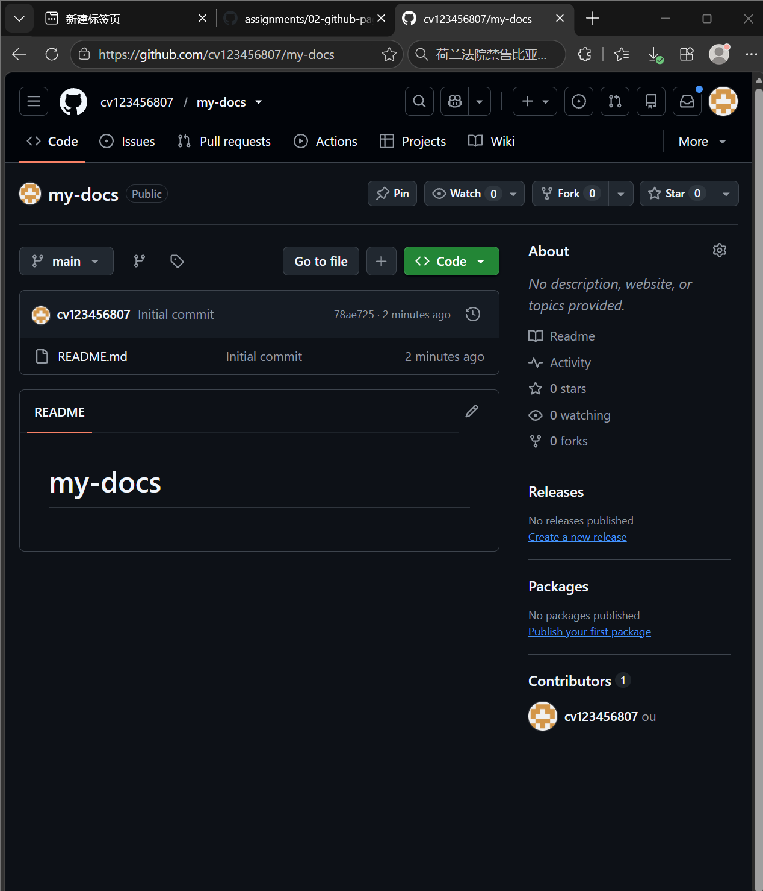
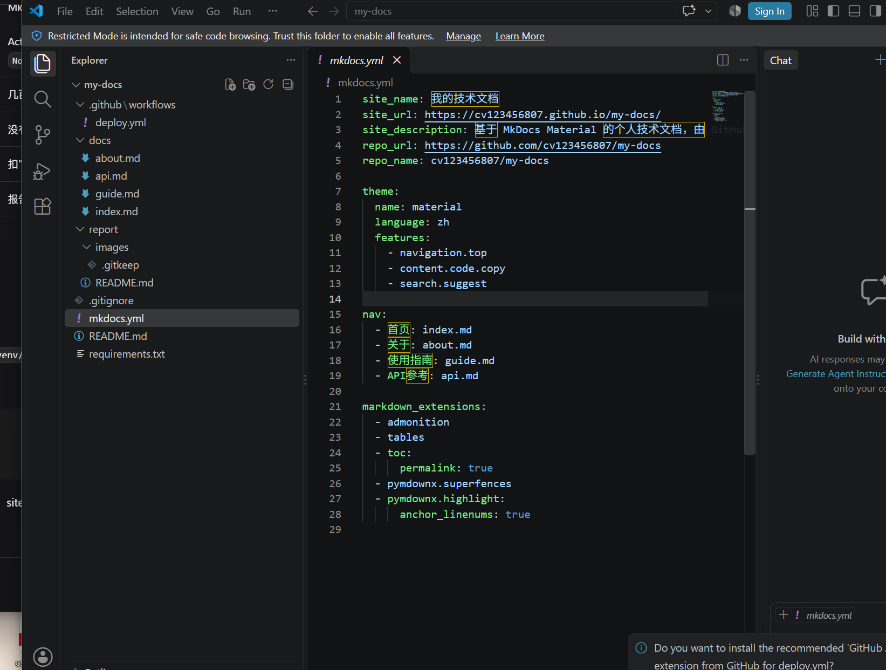
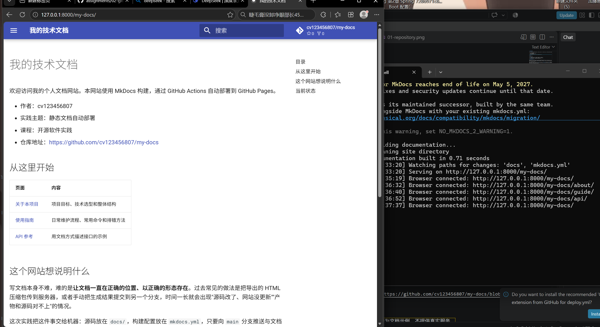
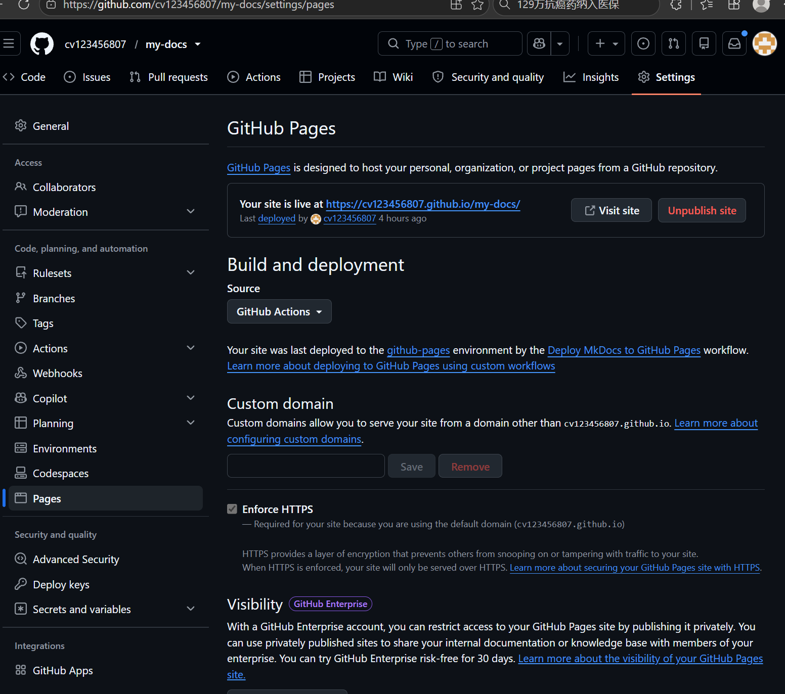
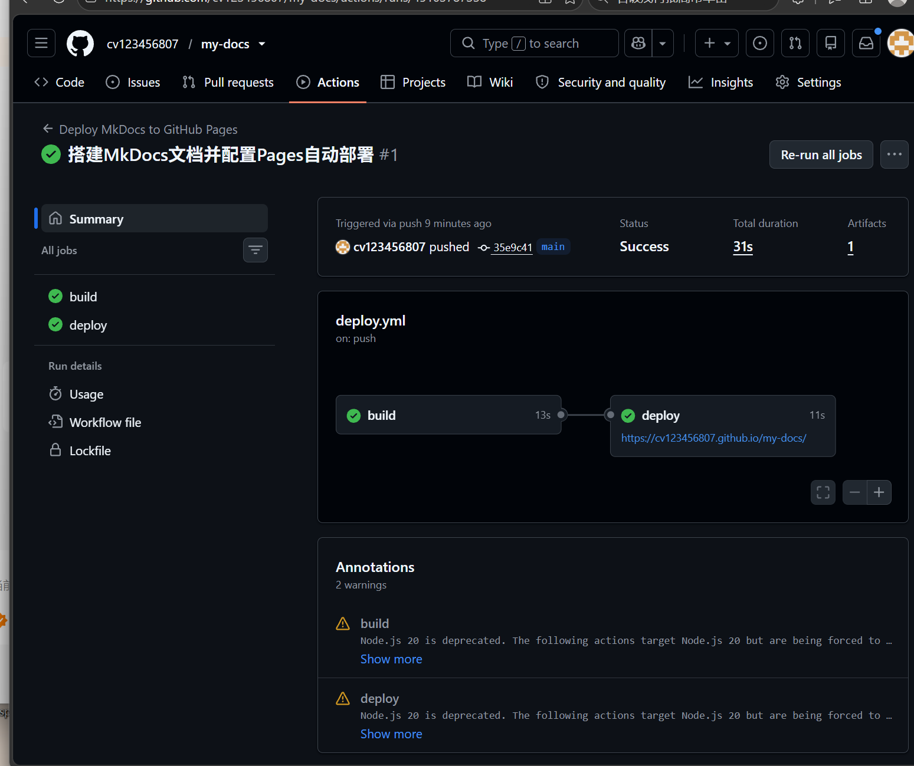
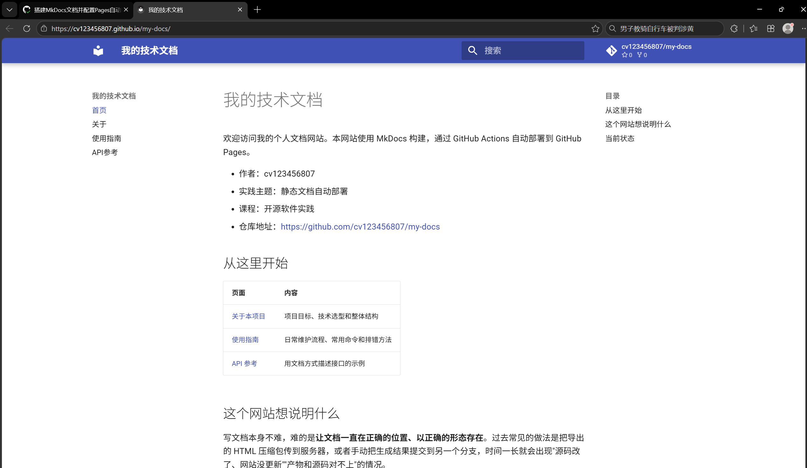
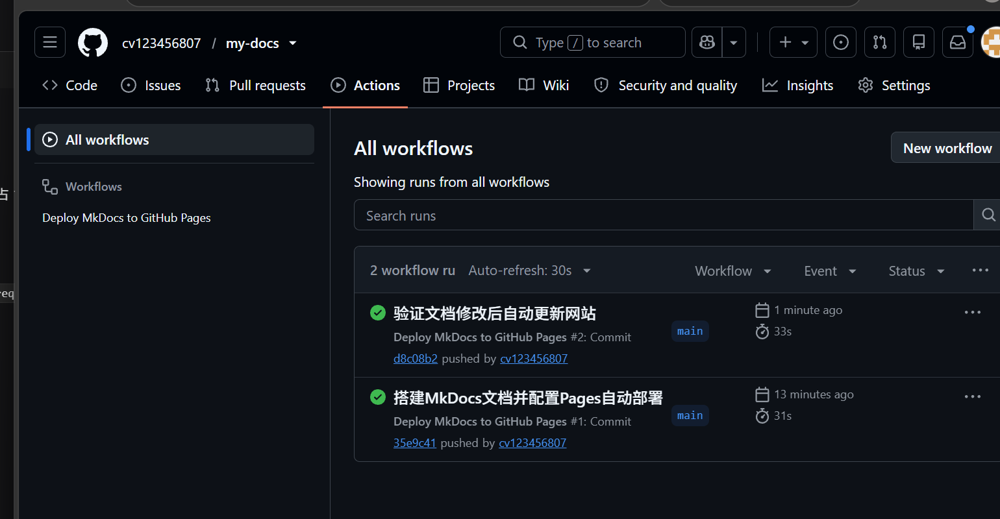
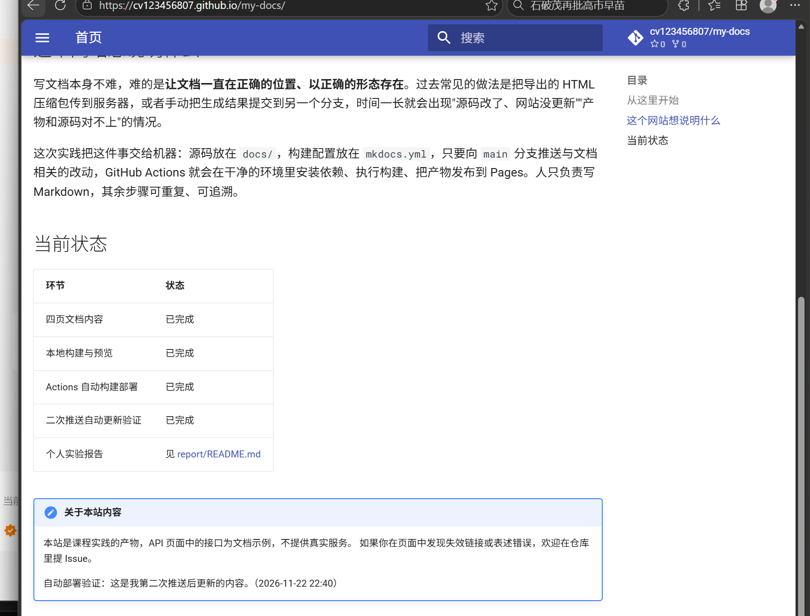

# 实践项目2：个人实验报告

## 1. 基本信息

- GitHub 登录名：cv123456807
- 个人仓库地址：<https://github.com/cv123456807/my-docs>
- 最终网站地址：<https://cv123456807.github.io/my-docs/>
- 完成时间：2026-11-23

## 2. 实践过程与关键截图

### 2.1 仓库创建

做了什么：登录 GitHub，用本人账号 `cv123456807` 新建仓库 `my-docs`，可见性选 Public，勾选 Add a README file 完成初始化，默认分支为 `main`。

为什么这样做：Pages 只对公开仓库免费提供站点访问，所以必须是 Public；勾选 README 后仓库立刻有 `main` 分支和一次初始提交，正好对应工作流里的 `branches: [main]`，避免后面还要改分支名。

结果：仓库首页显示所有者 `cv123456807`、仓库名 `my-docs`、`Public` 标识，分支下拉为 `main`，最新提交是 Initial commit。

### 2.2 项目结构与 MkDocs 配置

做了什么：在仓库根目录建立 `docs/`（index、about、guide、api 四页）、`mkdocs.yml`、`requirements.txt`、`.gitignore`、`.github/workflows/deploy.yml` 和 `report/`。

为什么这样做：`docs/` 是人写的源码，`site/` 是构建产物，每次构建都会整体重新生成，所以用 `.gitignore` 排除它；工作流必须放在 `.github/workflows/` 下 Actions 才能识别；`requirements.txt` 让云端环境能复现同一套依赖。

结果：目录结构与任务书一致，`site_url` 为 `https://cv123456807.github.io/my-docs/`，`nav` 里用的是相对 `docs/` 的路径（写 `index.md` 而不是 `docs/index.md`）。

### 2.3 本地构建与预览

做了什么：用 `py -3.14 -m venv .venv` 创建虚拟环境并激活，`pip install -r requirements.txt` 安装依赖，然后执行 `python -m mkdocs build --strict` 和 `python -m mkdocs serve`，在浏览器里逐页检查。

为什么这样做：`--strict` 会把“链接指向不存在的页面”这类警告升级为错误，和 Actions 里用的是同一条命令，本地先跑一遍能提前暴露内容问题；`serve` 提供本地预览，用来检查导航、表格、代码块和页面间链接。

结果：构建输出 `Documentation built in ...`，预览地址 `http://127.0.0.1:8000/` 正常打开，四页均可从导航进入，表格、代码块渲染正常，站内链接可以互相跳转。

### 2.4 Pages 设置

做了什么：进入 Settings → Pages → Build and deployment，把 Source 从默认值改为 **GitHub Actions**。

为什么这样做：本次使用官方 Pages 动作发布，需要 Pages 处于“由工作流发布”的模式；如果保留 Deploy from a branch，Pages 会去某个分支找静态文件，部署任务就会报找不到站点。

结果：Source 显示为 GitHub Actions，页面提示由工作流负责发布；此时还未发布，属正常状态。

### 2.5 Actions 首次构建和部署

做了什么：先 `git status` 查看改动，用 `git add` 逐个加入源码与配置，`git diff --staged` 复核暂存内容，再 `git commit` 并 `git push origin main`，然后到 Actions 页面看运行结果。

为什么这样做：`diff --staged` 是提交前唯一一次复核机会，可以确认没有把 `site/`、`.venv/` 这类不该提交的内容带进去，也能发现改错的文件。

结果：名为 Deploy MkDocs to GitHub Pages 的工作流被 push 触发，`build` 与 `deploy` 两个任务均为绿色，`deploy` 输出了本次发布的网站地址。

### 2.6 网站访问与四页导航检查

做了什么：打开 `https://cv123456807.github.io/my-docs/`，依次点击首页、关于、使用指南、API 参考四页。

为什么这样做：构建成功不等于站点可用，资源路径、样式和导航的问题只有在真实浏览器里才会暴露；项目站点地址必须带仓库路径 `/my-docs/`，只访问账号主页不是这个网站。

结果：四页均正常打开，样式与本地预览一致，左侧导航顺序与 `nav` 配置一致，站内链接可正常跳转。

### 2.7 第二次推送与自动更新验证

做了什么：在 `docs/index.md` 末尾增加一句“自动部署验证：这是我第二次推送后更新的内容”，提交并推送到 `main`，全程没有点击手动部署。

为什么这样做：只成功部署一次只能证明“能发布”，再改一次并自动生效才能证明“发布是自动的”；不点手动运行，才能说明这次运行确实由 push 触发。

结果：push 后 Actions 自动出现第二次运行并成功，按 `Ctrl+F5` 强制刷新后，网站首页出现了新增的那句话。

- 对应提交：<https://github.com/cv123456807/my-docs/commit/填提交号>
- 对应 Actions 运行：<https://github.com/cv123456807/my-docs/actions/runs/填运行号>

## 3. 问题与解决

### 问题一：在错误的目录执行 Git 命令，提示不是 Git 仓库

- 现象：执行 `git status` 报 `fatal: not a git repository (or any of the parent directories): .git`。
- 原因：`git clone` 是在一个已经叫 `my-docs` 的文件夹里执行的，于是仓库被生成在内层的 `my-docs\my-docs`，而外层只是一个普通文件夹，里面没有 `.git`。
- 解决：`cd` 进内层真正存放仓库的目录，用 `git remote -v` 确认远程地址是 `github.com/cv123456807/my-docs`，之后所有 Git 命令都在这一层执行。
- 结果：`git status` 恢复正常，提交与推送成功，远程仓库能看到新提交。

### 补充：未遇到其他错误时核对了什么

我额外核对了几项配置，确认部署成功不是碰巧：

| 核对项 | 确认结果 |
| --- | --- |
| 工作流文件路径与名称 | 位于 `.github/workflows/deploy.yml`，与 `paths` 中写的路径一致 |
| `permissions` 与部署所需权限 | 全局只有 `contents: read`，`deploy` 任务单独声明 `pages: write`、`id-token: write` |
| `needs: build` 的作用 | 构建失败时部署任务不会启动，线上保持上一次成功版本 |
| `.gitignore` 是否排除了 site/、.venv/ | 已排除，`git diff --staged` 中没有出现这两类文件 |
| `requirements.txt` 的版本范围 | 限定 `mkdocs<2`、`mkdocs-material<10`，避免大版本升级导致构建失败 |

## 4. 原理理解

### 4.1 `docs/` 与 `site/` 各保存什么？为什么不用手工修改 `site/`？

`docs/` 保存人写的 Markdown 源码，是内容的唯一来源；`site/` 是 `mkdocs build` 生成的 HTML、CSS、JS 和静态资源，是真正发给浏览器的产物。

每次构建都会按源码重新生成整个 `site/`，手工改的内容在下一次构建时会被整体覆盖，改了不起作用。而且产物体积大、内容重复，提交进仓库只会让改动记录变成噪音，也无法从产物反推源码改了什么。所以它属于随时可重建的东西，交给流水线生成，不进版本库。

### 4.2 本次工作流在什么情况下自动运行？

一种是向 `main` 分支推送，并且改动的文件命中 `paths`：`docs/**`、`mkdocs.yml`、`requirements.txt` 或工作流文件本身；另一种是在 Actions 页面手动触发 `workflow_dispatch`。

`paths` 过滤的作用是省掉无意义的构建。比如只改报告或 README 时网站内容并没有变化，没必要每次都跑一遍、占运行时间。

### 4.3 `build` 与 `deploy` 两个任务有什么区别？

`build` 负责产出：检出代码、准备 Python 3.12、安装依赖、执行 `mkdocs build --strict`，最后把 `site/` 作为 artifact 上传，它对仓库只有读权限。

`deploy` 负责发布：通过 `needs: build` 等构建成功后才启动，取回 artifact，凭借 `pages: write` 和 `id-token: write` 交给 Pages，并输出本次的网站地址。

拆成两个任务的好处有三点：构建阶段接触不到发布凭据，权限最小化；构建失败就不会产生半成品发布；日志里能直接看出问题出在生成还是上线。

### 4.4 只修改 `report/README.md` 会触发部署吗？为什么？

不会。`on.push.paths` 里只列了 `docs/**`、`mkdocs.yml`、`requirements.txt` 和工作流文件，`report/` 不在其中，所以这次提交不会创建运行记录。

这是有意设计的：报告改动不影响网站内容，没必要重新构建和发布。我的报告提交后 Actions 没有新运行，属于预期行为。

### 4.5 本次方案为何无需创建 `gh-pages` 分支？

旧做法是把构建产物提交到 `gh-pages` 分支，再让 Pages 从那个分支取文件发布，相当于多维护一个只放产物的分支。

本次用官方 Pages 动作：`upload-pages-artifact` 把产物作为本次运行的 artifact 上传，`deploy-pages` 再用 OIDC 令牌直接发布给 Pages 服务。产物只存在于这次运行和发布记录里，不进入任何长期分支，因此既不需要 `gh-pages` 分支，也不需要开启“允许 Actions 创建和批准 PR”的权限。
