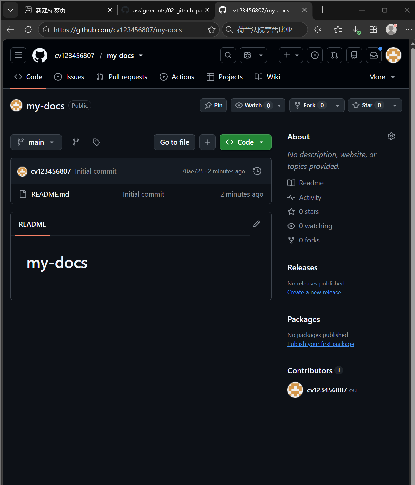
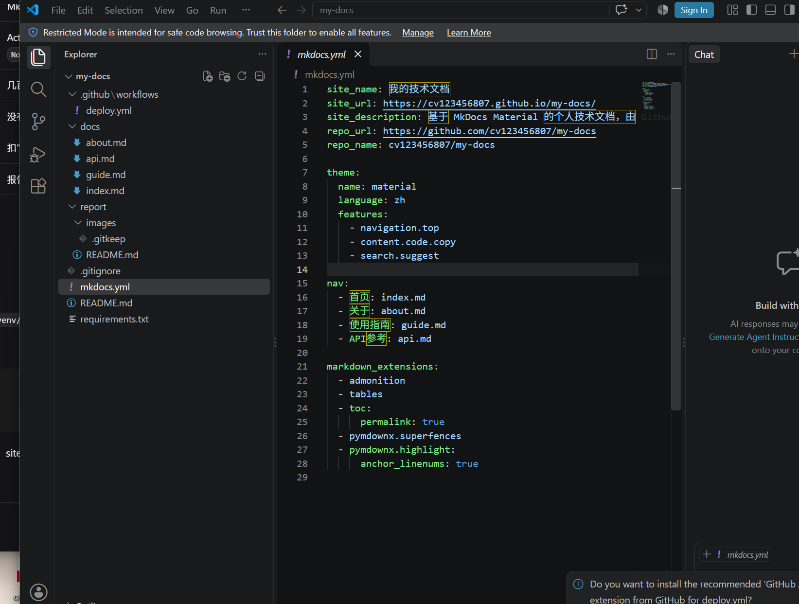
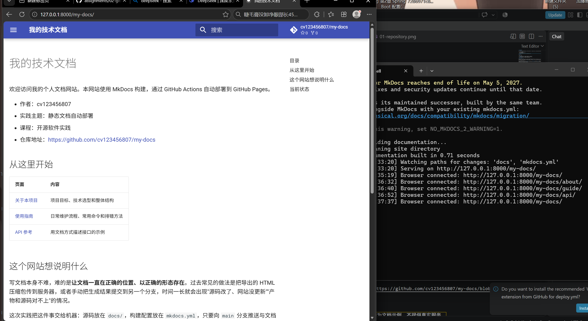
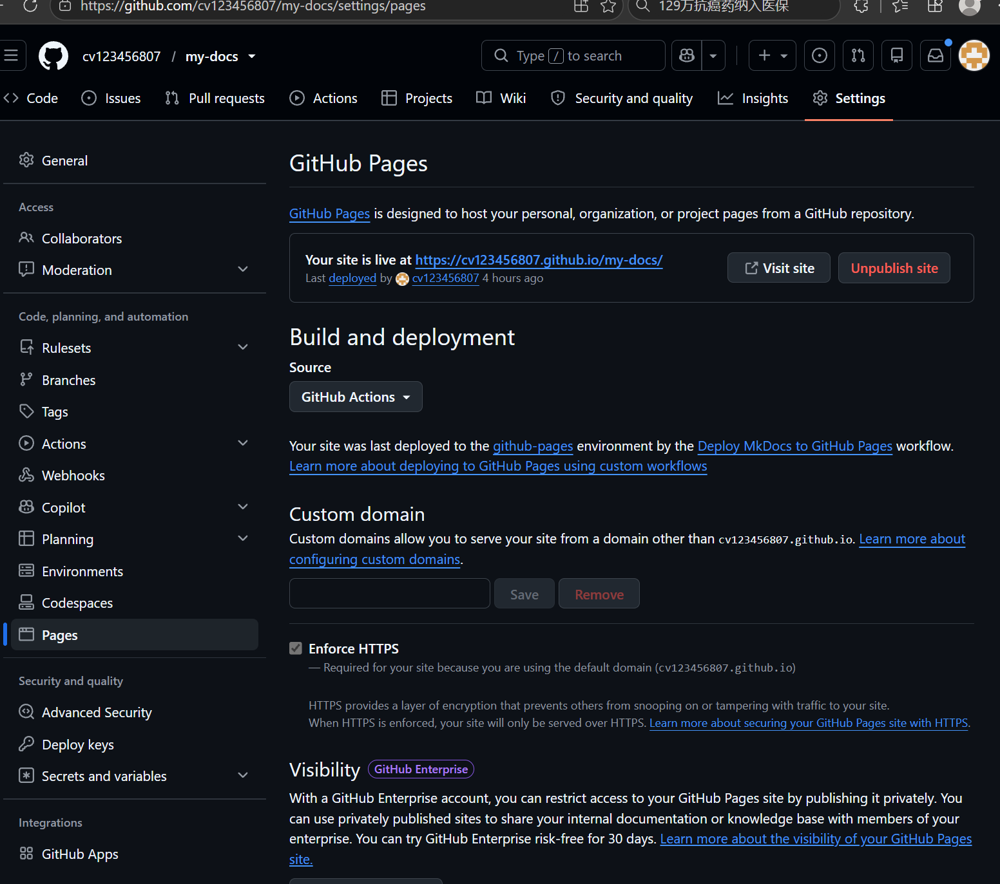
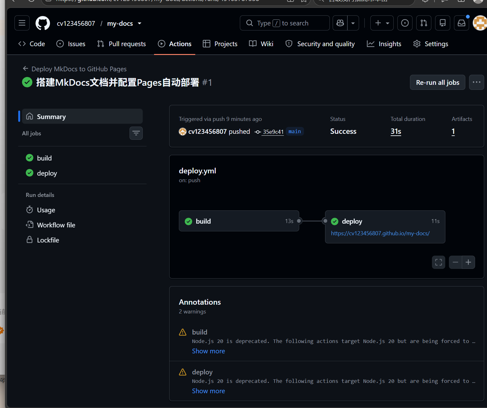
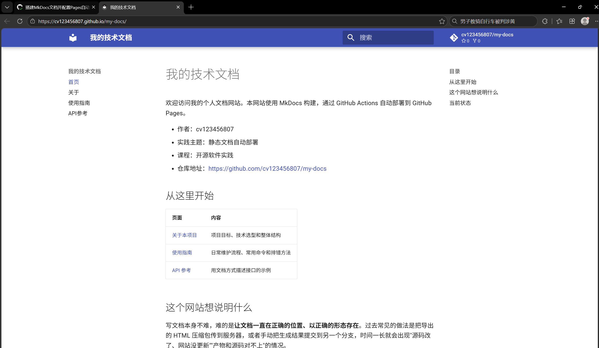
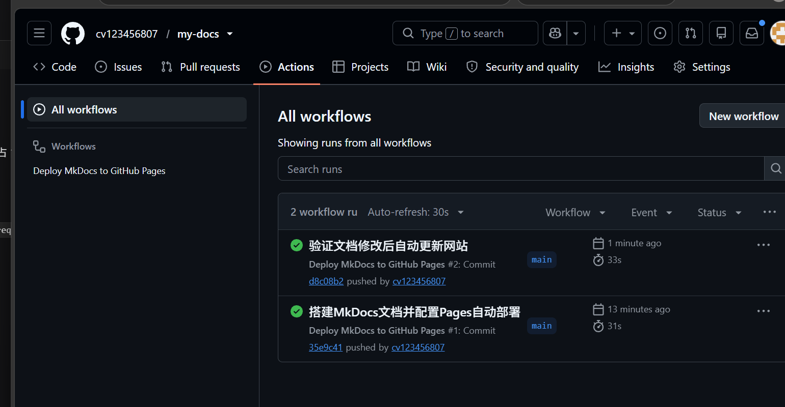
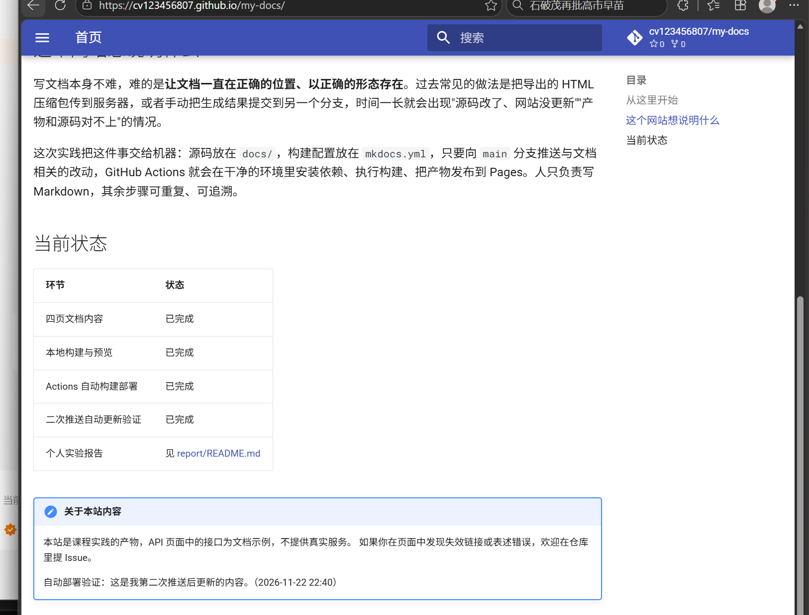

# 实践项目2：个人实验报告

<!--
使用方法：
1. 每一节都按「做了什么 / 为什么这样做 / 结果是什么」三句话写，缺一不可。
2. 占位符 <...> 全部替换成你自己的信息，不要留下任何方括号或尖括号。
3. 截图放进 report/images/，文件名与下面代码里的一致；图没放进去之前，页面会显示裂图，属正常。
4. 全文写完后，删除本段注释和所有【提示】行。
-->

## 1. 基本信息

- GitHub 登录名：cv123456807
- 个人仓库地址：<https://github.com/cv123456807/my-docs>
- 最终网站地址：<https://cv123456807.github.io/my-docs/>
- 完成时间：<2026-11-22>

## 2. 实践过程与关键截图

### 2.1 仓库创建

做了什么：<写你点了哪些按钮、填了什么>

为什么这样做：<提示：Public 与 Pages 的关系；默认分支 main 与工作流 branches 的关系>

结果：<写仓库首页上能核验的信息：所有者、仓库名、Public 标识、默认分支>

### 2.2 项目结构与 MkDocs 配置

做了什么：<创建了哪些目录和文件>

为什么这样做：<提示：docs/ 与 site/ 的分工；.gitignore 为什么要排除 site/>

结果：<写目录结构、site_url 的取值，以及 nav 里用的是相对 docs/ 的路径>

### 2.3 本地构建与预览

做了什么：<虚拟环境、装依赖、build --strict、serve>

为什么这样做：<提示：--strict 与 Actions 一致；为什么值得在本地先跑一遍>

结果：<写 build 的输出、预览地址、你检查了哪几项>

### 2.4 Pages 设置

做了什么：<Settings → Pages → Build and deployment → Source 改成什么>

为什么这样做：<提示：官方 Pages 动作与 "Deploy from a branch" 的区别>

结果：<写设置页显示的状态>

### 2.5 Actions 首次构建和部署

做了什么：<git add / diff --staged / commit / push>

为什么这样做：<提示：为什么提交前要看 diff --staged>

结果：<写 build、deploy 两个任务的颜色与 deploy 输出的地址>

### 2.6 网站访问与四页导航检查

做了什么：<访问了哪个地址、点了哪些链接>

为什么这样做：<提示：构建成功不等于站点可用>

结果：<写四页是否正常、样式是否与本地一致>

### 2.7 第二次推送与自动更新验证

做了什么：<在 docs/index.md 加了哪句话，怎么提交的>

为什么这样做：<提示：为什么不能点手动运行>

结果：<写第二次运行是否成功、刷新后是否看到新文字>

- 对应提交：<https://github.com/cv123456807/my-docs/commit/填提交号>
- 对应 Actions 运行：<https://github.com/cv123456807/my-docs/actions/runs/填运行号>

## 3. 问题与解决

<!--
写你真实遇到的错误。格式固定四段：现象（含报错原文片段）、原因、解决操作、结果。
一个都没遇到？就写成"核对过哪些日志和配置"，用表格列核对项与结论，见下面示例。
-->

### 问题一：<一句话概括现象>

- 现象：<原样抄下报错的关键一行>
- 原因：<你判断的原因>
- 解决：<你做了什么操作>
- 结果：<是否恢复，验证方式>

### 问题二：<一句话概括现象>

- 现象：
- 原因：
- 解决：
- 结果：

### 补充：未遇到错误时核对了什么

| 核对项 | 确认结果 |
| --- | --- |
| 工作流文件路径与名称 |  |
| `permissions` 与部署所需权限 |  |
| `needs: build` 的作用 |  |
| `.gitignore` 是否排除了 site/、.venv/ |  |
| `requirements.txt` 的版本范围 |  |

## 4. 原理理解

<!--
五问必须用自己的话答，每问 3～5 句，讲清"是什么 + 为什么这样设计"。
下面的【要点】是评分点，把它当作检查清单，不要照抄成答案句子。
-->

### 4.1 `docs/` 与 `site/` 各保存什么？为什么不用手工修改 `site/`？

【要点】源码与产物的区别；产物每次构建会被整体重写；提交产物会让 diff 变噪音、也无法反推源码改动。

<你的回答>

### 4.2 本次工作流在什么情况下自动运行？

【要点】trigger 有两类：push 到 main 且命中 paths；workflow_dispatch 手动。顺带说明 paths 过滤省掉了什么。

<你的回答>

### 4.3 `build` 与 `deploy` 两个任务有什么区别？

【要点】各自做什么、各自需要什么权限、`needs` 保证了什么、拆开的好处（权限最小化 + 失败不发布 + 日志可定位）。

<你的回答>

### 4.4 只修改 `report/README.md` 会触发部署吗？为什么？

【要点】对照 paths 列表判断；再说明这是预期行为。

<你的回答>

### 4.5 本次方案为何无需创建 `gh-pages` 分支？

【要点】旧方案"产物提交到分支"与官方方案"artifact + OIDC 发布"的差别；产物不需要长期留在分支里。

<你的回答>
